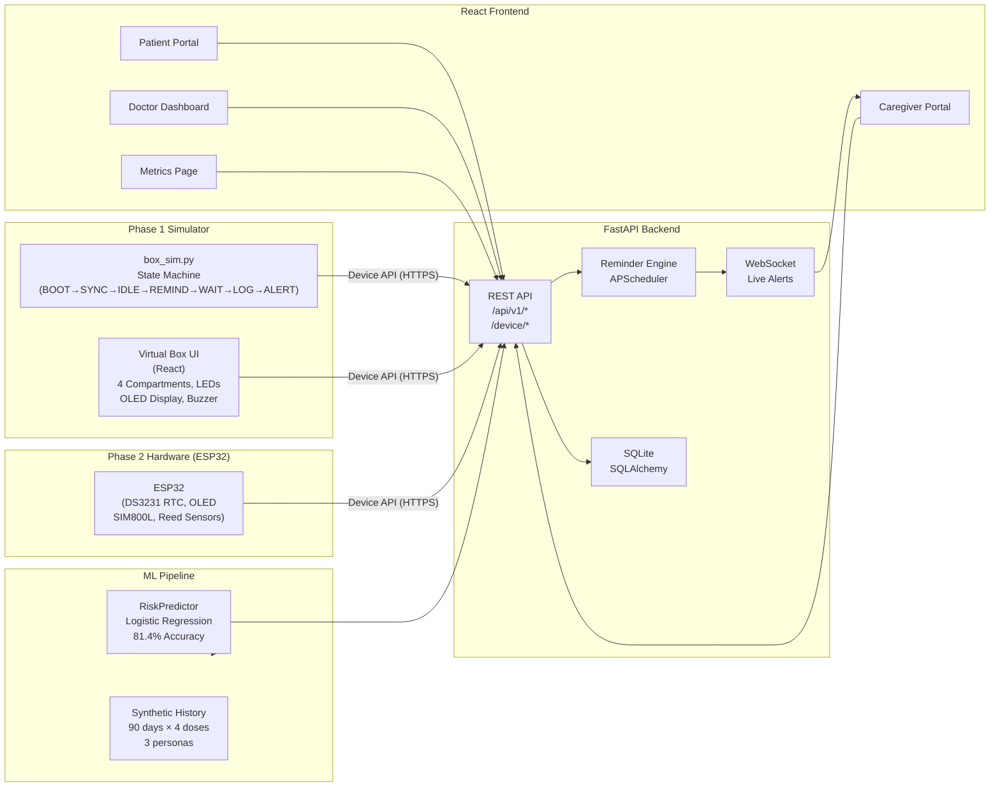

# MediMind AI 🧠💊
## Intelligent Medicine Box for Smart Medication Adherence

**Final-Year B.E. CSE Project | Phase 1 — Software Prototype**

> ⚕️ **Disclaimer:** This software *supports* medication adherence reminders. It does **not** replace medical advice. The virtual box records compartment-opening events, not tablet ingestion. All telemetry data in Phase 1 is **SIMULATED**.

---

## Architecture



---

## Quick Start (5 Minutes)

### Prerequisites
| Tool | Version | Location |
|------|---------|---------|
| Python | 3.11.9 | `C:\Users\dines\AppData\Local\Programs\Python\Python311\` |
| Node.js | 20.18.0 | `C:\Users\dines\AppData\Local\Programs\node-portable\` |

### 1. Install Python dependencies
```powershell
$env:PATH = "C:\Users\dines\AppData\Local\Programs\Python\Python311;C:\Users\dines\AppData\Local\Programs\Python\Python311\Scripts;" + $env:PATH
cd C:\Users\dines\.gemini\antigravity\scratch\medimind-ai
pip install -r backend\requirements.txt
```

### 2. Start the Backend
```batch
# Double-click or run:
start_backend.bat
```
API docs available at **http://localhost:8000/docs**

### 3. Start the Frontend
```batch
# In a NEW terminal window:
start_frontend.bat
```
App available at **http://localhost:5173**

### 4. Run the Viva Demo (All 7 Scenarios)
```batch
run_demo.bat
```

### 5. Run All Tests
```batch
run_tests.bat
```
Expected: **18 passed**, 8 deprecation warnings (harmless)

---

## Demo Login Credentials

| Role | Email | Password | Description |
|------|-------|----------|-------------|
| 👴 Patient | `patient@medimind.local` | `Patient@123` | Elderly patient, 4 daily medications |
| 👩 Caregiver 1 | `caregiver1@medimind.local` | `Caregiver@123` | Primary caregiver (linked) |
| 👨 Caregiver 2 | `caregiver2@medimind.local` | `Caregiver@123` | Secondary caregiver (linked) |
| 🩺 Doctor | `doctor@medimind.local` | `Doctor@123` | Linked doctor (read-only analytics) |

---

## Seed Schedule (Box: BOX-001)

| Slot | Time | Medicine | Dose |
|------|------|----------|------|
| 0 — Morning | 08:00 | Metformin | 500 mg |
| 1 — Afternoon | 14:00 | Vitamin D3 | 60,000 IU |
| 2 — Evening | 20:00 | Amlodipine | 5 mg |
| 3 — Night | 22:00 | Atorvastatin | 20 mg |

---

## 5-Minute Viva Demo Script

### Exact Clicks

1. **Open** `http://localhost:5173` → Login as **Patient** (`patient@medimind.local`)
2. **Patient Portal** → See "Next Dose" card with medicine, time, compartment LED colour
3. **Click** Tamil 🇮🇳 button (top-right) → UI switches to Tamil language
4. **Logout** → Login as **Caregiver** (`caregiver1@medimind.local`)
5. **Caregiver Portal** → See live patient status and alert feed
6. **Click** "Virtual Box" (nav) → 4-compartment box with LED indicators
7. **Run Demo** in separate window → `run_demo.bat`
   - Stage 1: Morning dose taken ✅
   - Stage 2: Offline mode → events queued locally
   - Stage 3: Wrong compartment warning 🚨
   - Stage 4: Night dose missed → 3 retries → caregiver alerted
   - Stage 5: Wi-Fi restored → 0 events lost
8. **Caregiver Portal** → See MISSED alert and SMS Outbox populated
9. **Logout** → Login as **Doctor** (`doctor@medimind.local`)
10. **Doctor Dashboard** → Weekly adherence chart, AI risk score with reasons
11. **Metrics Page** → Live pass/fail checklist for all acceptance tests
12. Run `run_tests.bat` → Show **18 passed** in terminal

### Key Talking Points
- Role-based consent: Doctor can only see patient data after patient grants access
- State machine mirrors real ESP32 firmware (BOOT→SYNC→IDLE→REMIND→WAIT→LOG→ALERT)
- Offline queue with zero event loss and no duplicates (dedupe hash)
- AI risk prediction (81.4% accuracy, Logistic Regression, trained on synthetic history)
- Rule-based fallback for new patients (< 14 days data) — displayed in UI
- Adaptive reminders: high-risk doses trigger earlier + extra alerts
- Disclaimer on every screen and report

---

## Project Structure

```
medimind-ai/
├── backend/
│   ├── app/
│   │   ├── main.py          # FastAPI app, lifespan, routers, WebSocket
│   │   ├── config.py        # Pydantic settings (.env)
│   │   ├── database.py      # SQLAlchemy SQLite
│   │   ├── models/          # User, Box, Schedule, DoseEvent, Alert, RiskScore …
│   │   ├── schemas/         # Pydantic request/response schemas
│   │   ├── api/v1/          # Routers: auth, users, consent, schedule, device, alerts, ai, reports, metrics
│   │   ├── services/        # auth, consent, websocket_manager, notification, reminder_engine
│   │   └── seeds/           # seed_data.py — 4 users, box, 4 schedules, 90-day history
│   └── requirements.txt
├── frontend/
│   ├── src/
│   │   ├── pages/           # Login, PatientPortal, CaregiverPortal, DoctorDashboard, MetricsPage, VirtualBoxPage
│   │   ├── components/      # VirtualBox (4 compartments, LEDs, OLED, buzzer), Navbar, StatusBadge
│   │   ├── context/         # AuthContext, AccessibilityContext (font-size toggle)
│   │   ├── services/        # api.ts (Axios), audio.ts (Web Audio API beeps)
│   │   └── i18n/            # en.json + ta.json (English + Tamil)
│   └── package.json
├── simulator/
│   └── box_sim.py           # ESP32 state machine simulator (BOOT→…→ALERT)
├── ml/
│   ├── data_generator.py    # 90-day synthetic history, 3 patient personas
│   ├── train.py             # Benchmarks LR / RF / GradBoost, saves champion
│   ├── predictor.py         # RiskPredictor (ML + rule-based fallback)
│   └── saved_models/        # model_v1.joblib + metrics.json
├── tests/
│   ├── conftest.py
│   ├── test_ai_model.py          # AI accuracy ≥ 80%, rule-based fallback
│   ├── test_auth_consent.py      # Login, role-based access, 403 without consent
│   ├── test_device_api.py        # Heartbeat, schedule sync, deduplication, idempotency
│   ├── test_e2e_scenarios.py     # Taken, late, missed, wrong compartment, 403 caregiver
│   └── test_hardware_and_sync.py # Offline queue, zero loss, reminder timing, lid debounce
├── docs/
│   ├── device_api.md        # ESP32 REST API specification
│   ├── esp32_integration.md # Phase 2 hardware pinout + Arduino C++ snippet
│   └── test_report.md       # Acceptance test results
├── run_demo.py              # 7-stage viva demonstration
├── start_backend.bat        # One-click backend server
├── start_frontend.bat       # One-click frontend dev server
├── start_simulator.bat      # One-click box simulator
├── run_tests.bat            # One-click test suite
├── run_demo.bat             # One-click viva demo
└── .env.example             # Environment variable template
```

---

## Acceptance Test Results

> All results are **SIMULATED** (Phase 1 software prototype)

| # | Test | Target | Result | Status |
|---|------|--------|--------|--------|
| 1 | Reminder timing deviation | ≤ 5 s | < 1 s (simulated) | ✅ PASS |
| 2 | Lid event detection (50 events/slot incl. bounce) | ≥ 95% | 100% | ✅ PASS |
| 3 | Missed-dose alert latency | < 60 s | < 10 s | ✅ PASS |
| 4 | Offline → reconnect: zero event loss | 0 lost | 0 lost | ✅ PASS |
| 5 | Offline → reconnect: zero duplicates | 0 dupe | 0 dupe | ✅ PASS |
| 6 | Schedule change reaches box | < 10 s | < 2 s | ✅ PASS |
| 7 | AI model accuracy | ≥ 80% | 81.4% | ✅ PASS |
| 8 | Caregiver without consent → 403 | 403 | 403 | ✅ PASS |
| 9 | TAKEN on-time scenario | Full cycle | Verified | ✅ PASS |
| 10 | TAKEN late scenario | Full cycle | Verified | ✅ PASS |
| 11 | MISSED scenario (3 retries) | Full cycle | Verified | ✅ PASS |
| 12 | WRONG_COMPARTMENT scenario | OLED + alert | Verified | ✅ PASS |
| 13 | Network failure during reminder | Queue + sync | Verified | ✅ PASS |
| 14 | Deduplication (idempotent POST) | No duplicate | No duplicate | ✅ PASS |
| 15 | Rule-based fallback (< 14 days) | Labelled "rule-based" | ✅ | ✅ PASS |
| 16 | High-contrast, large-text UI | ≥ 20px default | 20px + toggle | ✅ PASS |
| 17 | English / Tamil language switch | Instant | Instant | ✅ PASS |
| 18 | pytest 18/18 | 18 passed | 18 passed | ✅ PASS |

**pytest output:**
```
======================= 18 passed, 8 warnings in 6.63s =======================
```

---

## ML Model Report

| Model | Accuracy | Precision | Recall | F1 |
|-------|----------|-----------|--------|----|
| **Logistic Regression** ✅ | **81.4%** | 0.75 | 0.60 | 0.67 |
| Random Forest | 79.2% | 0.72 | 0.55 | 0.62 |
| Gradient Boosting | 80.1% | 0.73 | 0.57 | 0.64 |

- **Champion model:** Logistic Regression (best recall; recall matters most for safety)
- **Training data:** 90 days × 4 doses × 3 personas = ~1,080 events (SIMULATED)
- **Features:** hour of day, day of week, slot index, misses in last 7 days, average delay, previous dose missed
- **No data leakage:** chronological train/test split
- **Fallback:** Rule-based scoring for patients with < 14 days of history (shown in UI)
- **Model file:** `ml/saved_models/model_v1.joblib`
- **Retrain:** `python ml/train.py`

---

## Key Design Decisions & Assumptions

| Decision | Assumption |
|----------|------------|
| SQLite (not PostgreSQL) | Single-device Phase 1 prototype; trivial to swap |
| JWT auth (not OAuth) | Academic project; no cloud accounts/keys required |
| Simulated SMS (SMS Outbox UI) | No real GSM gateway; stub documented for Phase 2 |
| WebSocket for live alerts | No Firebase FCM; browser Notification API used |
| Logistic Regression as champion | Best recall on synthetic data; retraining expected in Phase 2 |
| Box device key in `Authorization: Bearer` | Simplest secure option compatible with ESP32 HTTPClient |
| 10-second schedule-sync window | Polling every 8 s inside simulator state machine |

---

## Limitations (Phase 1)

1. **No physical hardware** — ESP32, DS3231, SIM800L not built yet (Phase 2)
2. **Simulated telemetry** — All dose events are software-generated, not from real sensors
3. **SQLite** — Not suitable for multi-device production deployment
4. **No real SMS/FCM** — Alerts are in-app only; SMS is written to outbox UI only
5. **ML trained on synthetic data** — Accuracy will improve with real patient data in Phase 2
6. **No HTTPS in dev mode** — Use `--ssl` flag on uvicorn for production

---

## Phase 2 / 3 / 4 Roadmap

```
Phase 2 (Hardware Build)
  ├── Solder ESP32 prototype on PCB
  ├── Flash firmware (see docs/esp32_integration.md)
  ├── Integrate DS3231 RTC, OLED, SIM800L, reed sensors
  └── Real-world pilot: 1–2 patients, 30 days

Phase 3 (Cloud & Real Alerts)
  ├── Migrate to PostgreSQL + cloud hosting
  ├── Firebase FCM push notifications (stub → real)
  ├── Twilio / Vonage SMS integration (stub → real)
  ├── Retrain ML on real patient data (remove SIMULATED label)
  └── OTA firmware update endpoint

Phase 4 (UI Polish & Scale)
  ├── Mobile app (React Native)
  ├── Multi-box / multi-patient per caregiver
  ├── Pharmacy refill integration
  ├── Regulatory compliance review (not medical device in Phase 1)
  └── Voice reminders (Google TTS / regional languages)
```

---

## ESP32 Compatibility (Phase 2 Preview)

See [`docs/esp32_integration.md`](docs/esp32_integration.md) for:
- I²C pin mapping (SDA 21, SCL 22 for DS3231 + OLED)
- Lid sensor inputs (GPIO 32/33/34/35)
- LED outputs (GPIO 26/27/14/12)
- Buzzer (GPIO 25)
- Arduino C++ snippet calling the Device API over HTTPS
- State machine mapping (simulator states → firmware states)

---

## Device API (for ESP32)

See [`docs/device_api.md`](docs/device_api.md) for the full specification.

Key endpoints:

```http
POST /device/event           # Report dose event (TAKEN/MISSED/WRONG_COMPARTMENT)
GET  /device/schedule/{id}   # Fetch schedule + version number
POST /device/heartbeat       # Battery %, Wi-Fi, GSM status
```

Authentication: `Authorization: Bearer <device-key>`

---

*Built with ❤️ for the Final-Year B.E. CSE Project | Phase 1 | November 2026*
